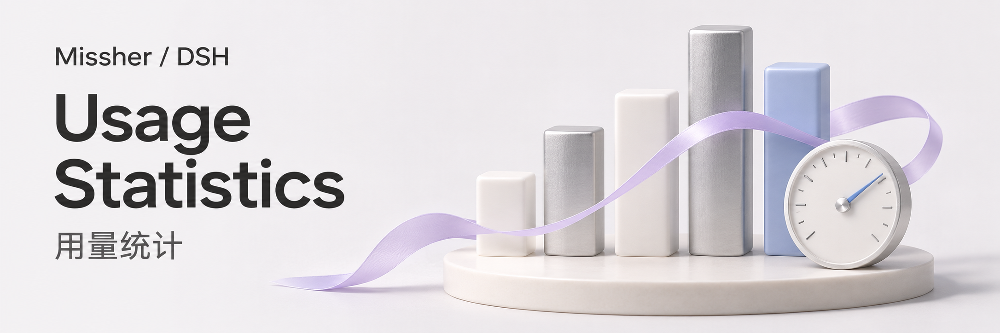
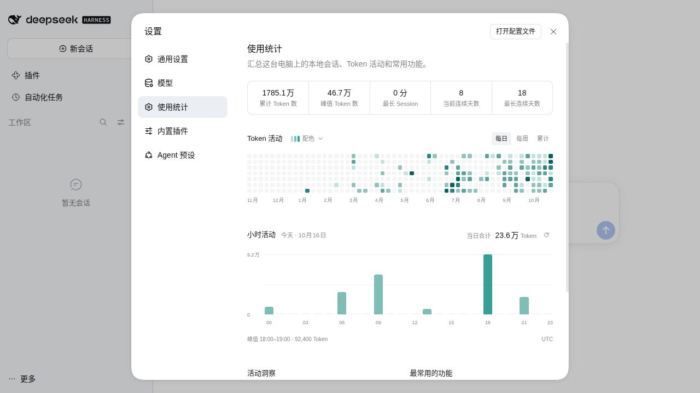
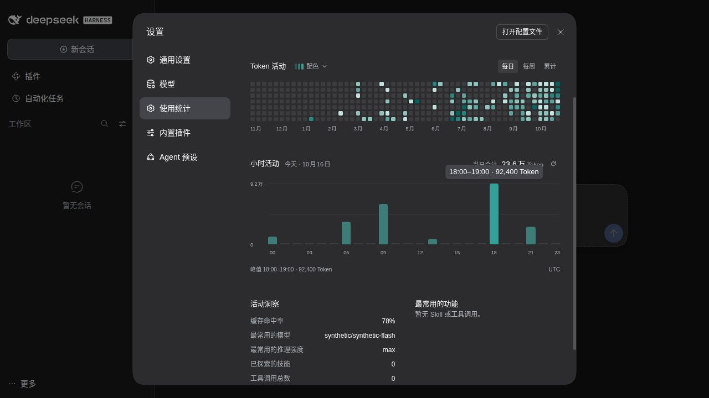

<h1>DSH Usage Statistics · 使用统计</h1>

把已有会话的 Token 用量、活动与常用工具看清楚。

  
  

<a href="#功能一览">功能一览</a> · <a href="#快速开始">快速开始</a> · <a href="#使用场景">使用场景</a> · <a href="#常见问题">常见问题</a> · <a href="#详细文档">详细文档</a> · <a href="../README.en.md">English</a>

---

<!-- current-source -->
当前开发源码：**1.0.1** · [分支 `main`](https://github.com/Missher12/Missher-DSH-Usage-Statistics/tree/main)。安装包以实际 Release 为准。
<!-- /current-source -->

## 功能一览

| 能做什么 | 说明 |
| --- | --- |
| **用量概览** | 累计 Token、峰值活动、有效耗时与连续使用天数。 |
| **每日与小时活动** | 53 周活动图和今天 0–23 点的小时分布。 |
| **模型与工具** | 查看历史常用模型、思考强度以及工具和 Skill 排行。 |
| **阅读与配色** | 深浅主题、颜色预设、自定义配色及精确用量提示。 |

<!-- existing-screenshots -->
## 界面示例

<table><tr><td></td><td></td></tr></table>

来自项目已有文档；截图版本与验证范围见<a href="../README.md">原始说明</a>，点击可放大。
<!-- /existing-screenshots -->

## 快速开始

1. 从 [Releases](https://github.com/Missher12/Missher-DSH-Usage-Statistics/releases/tag/v1.0.1) 下载对应版本的 `.tgz` 安装包。
2. 在 DSH **插件 → 添加插件** 中选择下载的文件，安装并启用；按宿主提示重新加载或正常重启。
3. 打开 **设置 → 使用统计**，查看当前 DSH 数据目录中的已有记录。

## 使用前了解

- 统计依据供应商已报告的 Token 用量，不是账单，也不推算缺失用量。
- 读取已有记录无需新增 API Key；原始会话保持只读，派生缓存可重建。

<!-- readme-expansion -->
## 使用场景

| 遇到的情况 | 怎样使用 |
| --- | --- |
| 想看最近哪几天、哪些时段使用得最多 | 用 53 周活动图和今天 0–23 点的小时分布查看使用节奏。 |
| 想知道经常使用哪些模型和工具 | 查看模型、推理强度、工具与 Skill 的历史排行。 |
| 想了解缓存命中与已记录 Token 的变化 | 在同一统计页观察用量指标，再按实际供应商账单核对费用。 |

## 第一次使用

1. 打开“设置 → 使用统计”，先看累计用量和每日活动。
2. 在每日、每周、累计视图之间切换，悬停或聚焦到一个颗粒查看具体数值。
3. 查看今天的小时图以及模型、工具排行；需要时刷新，并选择适合当前主题的配色。

### 一个具体例子

例如：先找出最近一个使用高峰日，再结合常用模型与工具记录，判断当时主要进行了哪类工作。排行描述已经记录的使用情况，不会修改模型或工具设置。

## 常见问题

为什么某些指标为空或比预期少？

统计依赖宿主持久化记录和供应商返回的用量。缺少用量、读取失败与确实没有活动应分别看待，不能把缺失记录直接解释为零消耗。

打开这个页面会增加模型费用吗？

不会。插件读取已有会话并维护独立派生缓存，不为显示图表调用模型，也不修改原始会话来制造统计。

它和工作仪表盘有什么区别？

使用统计侧重长期活动、使用习惯和模型／工具排行；工作仪表盘侧重当前会话状态、目标、任务清单和项目工作情况。

## 搭配使用

可以同时使用 [工作仪表盘](https://github.com/Missher12/Missher-DSH-Dashboard) 与 [Context Manager](https://github.com/Missher12/Missher-DSH-Context-Manager)：分别回答“正在做什么”“长期怎么使用”和“当前上下文有多少”这几个问题。

## 升级与数据

插件只写独立派生缓存，原始记录由宿主维护。升级通过相同插件实例完成；不要为了刷新统计删除整个 profile、会话目录或凭据。
<!-- /readme-expansion -->

## 详细文档

[项目原说明](../README.md) · [安装说明](../INSTALL.md) · [验证记录](../VALIDATION.md) · [截图来源](../docs/images/README.md) · [许可证](../LICENSE)

原有功能细节、配置、截图与验证记录保留在上述文档中，历史结论按其注明的版本理解。
