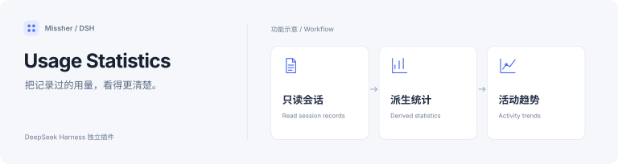

<h1>DSH Usage Statistics · 使用统计</h1>

把已有会话的 Token 用量、活动与常用工具看清楚。

  
  

<a href="#功能一览">功能一览</a> · <a href="#快速开始">快速开始</a> · <a href="#详细文档">详细文档</a> · <a href="../README.en.md">English</a>

---

<!-- current-source -->
当前开发源码：**1.0.0** · [分支 `main`](https://github.com/Missher12/Missher-DSH-Usage-Statistics/tree/main)。安装包以实际 Release 为准。
<!-- /current-source -->

## 功能一览

| 能做什么 | 说明 |
| --- | --- |
| **用量概览** | 累计 Token、峰值活动、有效耗时与连续使用天数。 |
| **每日与小时活动** | 53 周活动图和今天 0–23 点的小时分布。 |
| **模型与工具** | 查看历史常用模型、思考强度以及工具和 Skill 排行。 |
| **阅读与配色** | 深浅主题、颜色预设、自定义配色及精确用量提示。 |

<!-- existing-screenshots -->
## 界面示例

<table><tr><td></td><td></td></tr></table>

来自项目已有文档；截图版本与验证范围见<a href="../README.md">原始说明</a>，点击可放大。
<!-- /existing-screenshots -->

## 快速开始

1. 从 [Releases](https://github.com/Missher12/Missher-DSH-Usage-Statistics/releases/tag/v1.0.0) 下载对应版本的 `.tgz` 安装包。
2. 在 DSH **插件 → 添加插件** 中选择下载的文件，安装并启用；按宿主提示重新加载或正常重启。
3. 打开 **设置 → 使用统计**，查看当前 DSH 数据目录中的已有记录。

## 使用前了解

- 统计依据供应商已报告的 Token 用量，不是账单，也不推算缺失用量。
- 读取已有记录无需新增 API Key；原始会话保持只读，派生缓存可重建。

## 详细文档

[项目原说明](../README.md) · [安装说明](../INSTALL.md) · [验证记录](../VALIDATION.md) · [截图来源](../docs/images/README.md) · [许可证](../LICENSE)

原有功能细节、配置、截图与验证记录保留在上述文档中，历史结论按其注明的版本理解。
