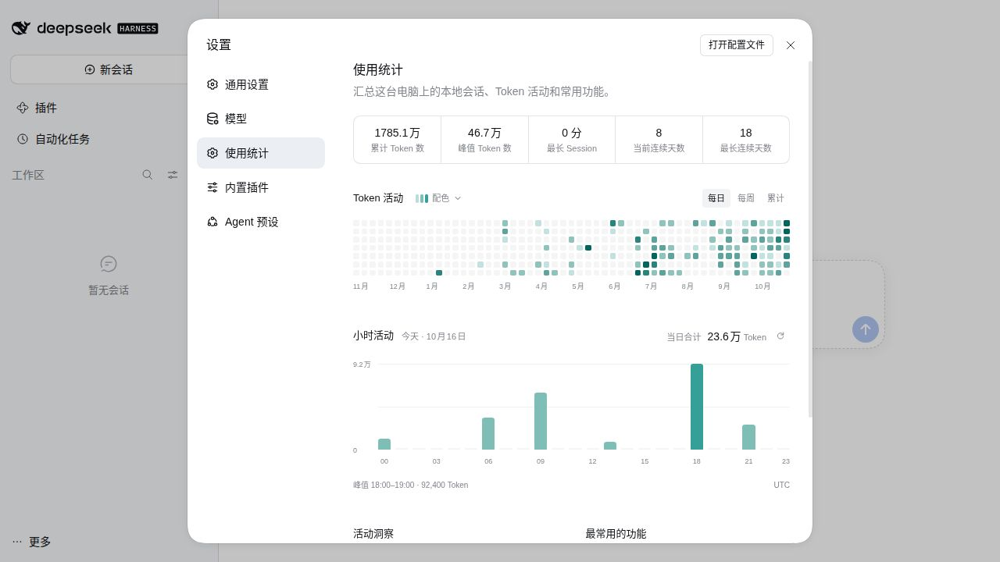
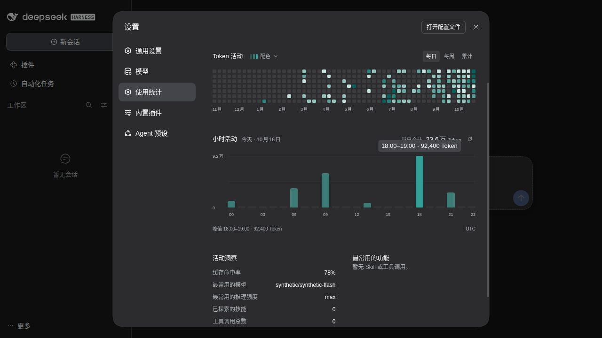

# DeepSeek Harness Usage Statistics

[简体中文](README.md) · [Downloads](https://github.com/Missher12/Missher-DSH-Usage-Statistics/releases) · [Desktop application](https://github.com/Missher12/Missher-DeepseekHarness-Desktop)

Local session and Token statistics with daily and hourly activity charts for DeepSeek Harness.

An independently installable, removable Harness Bundle named `@missher/dsh-usage-statistics`. Open **Settings → Usage Statistics** after enabling it. Reading existing records does not require an API key. The current version is **0.2.2**: installation, Loader and install-lifecycle acceptance ran on three real hosts, while the real Web interface was reviewed only on the plain official 0.2.1-alpha.5 runtime. See Releases for the installable archive and checksums.

## Compatibility range (0.2.2)

Declared peers:

- `@deepseek-ai/dsh*` peers stay `*`: the runtime gate is the Host's own `evaluatePluginCompatibility`, with no plugin-side allowlist, no `plugin allow-version` grant and no shim package.
- `@deepseek-ai/cordis`: `^4.0.4 || ^4.0.5-alpha.1`.
- `@deepseek-ai/schemastery`: `^3.18.4 || ^3.18.5-alpha.1`.
- The development SDK stays locked to `0.2.0-rc.2` (the `link:` overrides in `pnpm-lock.yaml` / `pnpm-workspace.yaml`) so the development environment is reproducible; that lock does not narrow where the plugin may run.

Library versions actually exercised with the same tarball:

| Host | Runtime | Cordis | Schemastery |
| --- | --- | --- | --- |
| Missher community rc.2 | 0.2.0-rc.2 | 4.0.4 | 3.18.4 |
| Missher community alpha.2 | 0.2.1-alpha.2 | 4.0.5-alpha.1 | 3.18.5-alpha.1 |
| Plain official npm runtime | 0.2.1-alpha.5 | 4.0.5 | 3.18.5 |

`4.0.5` and `3.18.5` fall inside the declared ranges and were actually run on the official runtime; the range still does not claim that every other version was exercised.

Behaviour when an interface is missing, in three distinct cases:

- **A whole required service is absent** (for example no `sessionPersistence` in the composition): the plugin's required injection keeps it waiting and **the Host's Loader audit reports** `pending (waiting for service: sessionPersistence)`. The `usageStatistics` service does not exist, so no fake "0 usage" statistics appear.
- **The service exists but a member is missing** (for example no `storageDomain.open`, or `sessionPersistence` without `stat`): the plugin reports the exact missing member during initialization and stays unavailable.
- **Only an optional capability is missing** (no live-session `sessions` index): usage statistics stay complete, with unchanged cache and aggregation semantics.

## Screenshots



**Light main view** — package version 0.2.2; synthetic data (152 synthetic sessions, 17 850 900 Tokens total); captured from the real Web settings page of the plain official 0.2.1-alpha.5 runtime on Linux x64 at 1280×720. No personal sessions, notes, machine paths or credentials.



**Dark theme and hourly activity** — same version and same synthetic data; today's 24 hours total 236 100 Tokens, with one hour focused/hovered. The tooltip was actually displayed through a click and keyboard focus in this round; the pointer-enter behaviour reuses earlier, unchanged local.9 evidence. Capture method: raw JPEG frames, lossless format conversion to PNG only, no pixel edits, no generated or composited imagery.

See [docs/images](docs/images/README.md) for the files and their provenance notes.

## Features

- Total Tokens, peak daily Tokens, longest active session duration, and current/longest activity streaks.
- A 53×7 activity grid covering the last 53 weeks, with daily, weekly and cumulative views and exact-value tooltips.
- A frameless chart of today's 24 clock hours. Hover to see the time range and exact Token count, navigate hours with arrow keys, or refresh manually.
- A shared chart color preference: follow the theme, choose one of five presets, or select a custom color.
- Input cache hit rate, most-used model and reasoning effort, and tool/skill rankings; unreadable sessions and missing usage reports are disclosed.
- English/Chinese, host light/dark themes, a cached snapshot and retry controls.

## Host and platform support

Runtime dependencies are the Host's `sessionPersistence`, `storageDomain`, Typert Remote, `settings.section` and native UI primitives. The plugin does not call Missher-only extension APIs and needs no separate compatibility plugin.

**Exercised for 0.2.2**: the same tarball was installed, booted, snapshotted, rebuilt from a v3 derived cache into v4, restarted, removed and reinstalled in separate processes on the Missher community rc.2, the Missher community alpha.2 and the plain official npm runtime 0.2.1-alpha.5. Durable session bytes and cache bytes were preserved, cache domain 1 / row 4 is unchanged, the installer used pnpm 11.7.0, each profile was isolated with empty credentials, and no model request was submitted. The real Web settings-page review ran **only** on the plain official 0.2.1-alpha.5 runtime (Linux x64).

**Not verified in this round**: the native daily Electron surface, macOS, Windows, Apple Silicon and other host versions. Desktop application tests are not treated as plugin tests. See [VALIDATION.md](VALIDATION.md) for the layer table.

DSH peer ranges remain `*`, so a host is not rejected by its version number alone; this is not a promise of compatibility with every version. A missing required service is reported by the Host Loader as waiting, a missing member is reported by the plugin, and neither path uses a version exemption.

## Install and use

1. Download `missher-dsh-usage-statistics-<version>.tgz` from [Releases](https://github.com/Missher12/Missher-DSH-Usage-Statistics/releases) and verify it against that release's `SHA256SUMS`. GitHub's automatic Source code archives are not the plugin installer.
2. In Desktop, open **Plugins → Add plugin → Package name or address**. Enter the downloaded archive's absolute path, or its public download URL. The archive includes all runtime entry points; users do not need to build it or provide an SDK.
3. Enable/reload when prompted, then open **Settings → Usage Statistics**. Existing records are aggregated; an empty profile shows an empty state.
4. Turn off the plugin's enable switch in plugin management to disable it. Turn it back on to restore it. If the host is not using hot reload, restart normally when prompted.
5. Uninstall `@missher/dsh-usage-statistics` from the same plugin page. Its settings section, service and styles are removed with the plugin lifecycle. Disabling/uninstalling does not delete sessions, model settings or credentials. Rebuildable caches and color preferences remain.

Back up the active profile before updating. Keep the same package name and avoid installing an older renamed copy alongside it.

For an initialized **Web/CLI profile** named `web`:

```sh
dsh plugin --profile web add /absolute/path/to/missher-dsh-usage-statistics-0.2.2.tgz
dsh --profile web --no-open
# After stopping the Web profile:
dsh plugin --profile web remove @missher/dsh-usage-statistics
```

Use the Desktop plugin page for the application's own profile. The public repository also contains built `lib` entry points and a Bundle manifest, so a Git source can be packaged without a build script. The versioned release archive is the reproducible distribution tested here; this packaging revision does not claim a new Git-install test.

“Local plugin directory” means an already-built directory with resolvable runtime dependencies. Unpacking an archive alone does not prepare peers for a linked-directory installation. Development SDK links are local to the developer's machine; distribute the `.tgz`, not those links. See [INSTALL.md](INSTALL.md).

## Data and accounting

Only readable sessions in the current Harness data directory are included. This is recorded usage, not a provider bill, account quota check or estimate, and it does not aggregate other computers.

- Tokens include uncached input, output, cache reads and cache writes. Reasoning Tokens are not added again on top of output. Missing usage is not estimated. Reported failed attempts and retries count; duplicate settlements within an attempt and inherited session prefixes are not double-counted.
- Daily and hourly charts use the same time zone, defaulting to the system zone. Accepted usage events are assigned to the hour when they were recorded; requests spanning hours are not spread evenly. Repeated daylight-saving hours are merged and skipped hours remain zero. Opening the page or refreshing reloads data; an older cached date is not labeled “today.”
- Cache hit rate is cache-read Tokens divided by all input Tokens. Session duration sums completed turns' active durations, excluding idle time between turns.
- Model and reasoning-effort values describe recorded history, not current defaults or declared model capabilities. The combined tool/skill ranking shows the top five entries.

The Host reads through the session persistence service and writes only the plugin's rebuildable `missher_usage_statistics` cache (domain 1, row format 4). The browser stores a snapshot and color preference. The plugin does not scan private log formats directly, edit original sessions, or repair/migrate historical logs. Unreadable records are reported as omitted.

It registers no model tools, adds no prompts, calls no model and uploads no statistics. It does not provide cross-device sync, cost forecasts or current-session context management. Large histories may take longer to scan; the default refresh budget is 12 seconds. Advanced options are `timeZone` (an IANA time zone) and `refreshTimeoutMs` (10–60000 milliseconds).

## Development

End users install the built archive. Source development requires Node.js, pnpm 11.7.0 and a built DSH 0.2.0-rc.2 SDK:

```sh
node scripts/link-harness.mjs /absolute/path/to/built-harness
pnpm install --frozen-lockfile
pnpm typecheck
pnpm test --maxWorkers=1
pnpm build
pnpm pack:bundle
```

The `harness-sdk` link, development dependencies and local paths are excluded from the distribution. Use an isolated copy if the working checkout is linked to a running application. `scripts/verify-profile.mjs` is the **legacy isolated-install entry point for the fixed development SDK only**: it requires the acceptance runtime to match the development SDK version (`DSH_SOURCE_DIR=/absolute/path/to/built-harness`) and creates its own acceptance profile. The 0.2.2 wide-version acceptance across rc.2, alpha.2 and the official alpha.5 runtime ran inside the reviewer's private evidence directory and is not shipped with this repository, so no public command is offered for it.

## Attribution and support

MIT licensed. The initial implementation was extracted from Desktop 0.5.10 / Harness 0.1.5-rc.2 at revision `ca0085cabd778685b83c79ff40e49d637014b28f`. This plugin maintains later API adaptations, hourly activity and chart colors. [provenance.json](provenance.json) lists original files and hashes.

The archive retains the [project MIT license](LICENSE), [DeepSeek MIT notice](licenses/deepseek-harness-MIT.txt) and [Zod MIT notice](licenses/zod-MIT.txt). The browser entry bundles Zod 4.4.3; Cordis, Schemastery and DSH services are supplied by host dependencies.

Report the host/plugin versions, platform, reproduction steps and redacted errors in [Issues](https://github.com/Missher12/Missher-DSH-Usage-Statistics/issues). Do not attach credentials or private session content.
